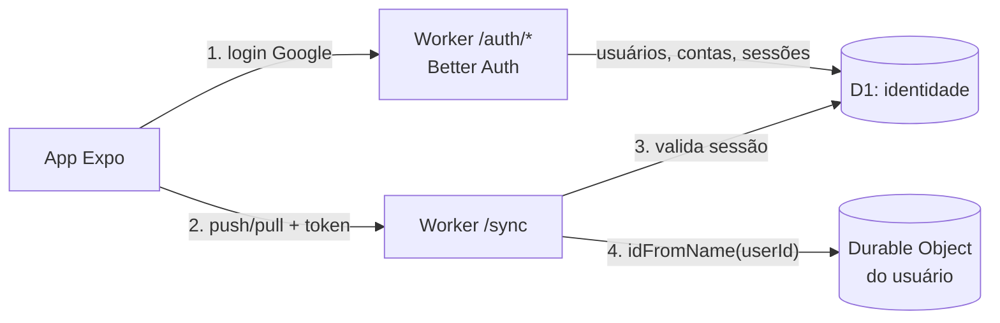

# ADR-0008: Autenticação com Better Auth no Worker e login Google

- **Status:** Proposto
- **Data:** 2026-11-18
- **Fase:** 2
- **Relacionado:** [ADR-0005](0005-cloudflare-como-plataforma-de-nuvem.md), [ADR-0006](0006-estrategia-de-sincronizacao-offline.md), [ADR-0007](0007-frontend-expo-universal.md)

## Contexto

- A Cloudflare **não tem serviço de identidade para usuários finais** (ADR-0005).
- **Custo zero**, sem exceção (decisão do dono do produto).
- **Offline (QA-1):** a autenticação **nunca pode impedir** o registro de um treino.
- **LGPD (QA-2):** menos terceiros com dados pessoais = menos contratos, menos transferência internacional e exclusão mais simples.
- Clientes: app Expo (Android por APK, web/PWA). **Sem App Store**, então "Sign in with Apple" não é obrigatório.
- Identidade é um **subdomínio genérico** (Fase 1): não deve consumir esforço de construção.

## Opções consideradas

| # | Opção | Prós | Contras |
|---|---|---|---|
| A | **Better Auth** (biblioteca open source em TypeScript) rodando no **nosso Worker**, com dados no **D1** | Gratuito; dados na nossa conta Cloudflare; suporta OAuth, e-mail/senha e passkeys; plugin para Expo | Somos nós que operamos (rotação de segredos, atualização da biblioteca); a superfície de segurança é nossa, embora a lógica sensível seja da biblioteca |
| B | **Clerk** | Melhor experiência de integração com Expo; plano gratuito generoso | Dados pessoais num terceiro (EUA); dependência de fornecedor num ponto crítico; o modelo de preços pode mudar |
| C | **Auth0 / Firebase Auth** | Maduros, gratuitos na nossa escala | Mesmos contras de B; Firebase traz o ecossistema Google junto |
| D | **Supabase Auth** | Gratuito | Projetos gratuitos **pausam por inatividade**: com 20 usuários, o risco de o login ficar fora do ar é real |
| E | **Implementação própria** | Aprendizado | Construir autenticação é o exemplo clássico do que **não** construir; contraria a classificação como subdomínio genérico |

## Decisão (proposta)

**Opção A: Better Auth no Worker, com tabelas de identidade no D1.**

### Método de login no MVP: **Google (OAuth)**

- Gratuito e sem necessidade de **serviço de e-mail**. E-mail/senha exige envio de e-mails (recuperação de senha, verificação), o que significa mais um provedor e mais custo potencial.
- Praticamente todo usuário Android já tem uma conta Google.
- E-mail/senha ou passkeys podem ser habilitados depois, porque a biblioteca já suporta.

### Integração com a arquitetura

1. **O userId é a chave de roteamento:** o Worker valida a sessão e encaminha para o Durable Object `idFromName(userId)`. O isolamento entre usuários é garantido pela **topologia**: não existe consulta capaz de "esquecer o WHERE".
2. **D1 guarda só a identidade** (usuários, contas OAuth, sessões). Os dados de treino ficam nos Durable Objects (ADR-0006).

### Autenticação e offline: regras

1. **O login é exigido uma vez**, no primeiro uso, porque é preciso saber de quem são os dados.
2. **Sessão de longa duração** (ex.: 60 dias, renovada a cada uso) guardada em armazenamento seguro (`expo-secure-store` no celular).
3. **Sessão expirada não bloqueia nada local.** O app continua registrando treinos normalmente; os eventos ficam pendentes. Ao voltar a conexão, ele pede um novo login e então sincroniza.
4. **Os eventos locais pertencem ao userId do aparelho.** O servidor rejeita um push cujo token não corresponda ao dono do log.
5. **Logout com eventos pendentes:** o app avisa que há treinos não sincronizados antes de sair. Logout nunca apaga silenciosamente dados não enviados.

## Consequências

- ✅ Custo zero e nenhum terceiro além do Google (que só autentica).
- ✅ LGPD: dados pessoais na nossa conta; a exclusão de um usuário = apagar as linhas no D1 + o Durable Object dele.
- ✅ Autenticação desacoplada do offline: o caso "expirou na academia" está tratado.
- ⚠️ Operamos a autenticação: segredos do OAuth em Wrangler secrets, atualização de dependências e monitoramento de falhas de login.
- ⚠️ Dependência do Google para entrar. Quem não tiver conta Google fica de fora até habilitarmos outro método (aceitável com 20 usuários).
- ⚠️ OAuth no app Expo exige configuração de *redirect* (deep link) no Android e na web. Será validado no spike da Fase 3.
- 🔁 **Gatilhos de revisão:** necessidade de e-mail/senha (exige um ADR de serviço de e-mail); publicação na App Store (Sign in with Apple passa a ser obrigatório quando há login social); a biblioteca deixar de ser mantida.
