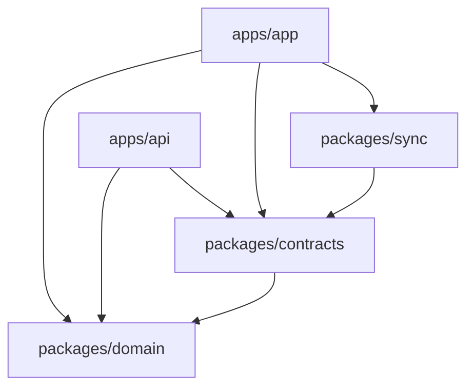

# ADR-0009: Monorepo com pnpm + Turborepo e fronteiras verificadas automaticamente

- **Status:** Aceito
- **Data:** 2026-11-18
- **Fase:** 2
- **Relacionado:** [ADR-0004](0004-typescript-como-linguagem-do-backend.md), [ADR-0006](0006-estrategia-de-sincronizacao-offline.md), [ADR-0007](0007-frontend-expo-universal.md)

## Contexto

- Uma linguagem só (TypeScript) com código compartilhado entre o app (Expo) e a API (Worker): domínio, schemas de eventos e protocolo de sincronização.
- O ADR-0004 apontou o risco de **acoplamento indevido**: com tudo no mesmo repositório, nada impede o app de importar o código interno da API, ou o domínio de importar React.
- 1 desenvolvedor: a estrutura precisa ser **simples**, sem dezenas de pacotes.

## Opções consideradas

| Tema | Opções | Escolha |
|---|---|---|
| Repositório | Multi-repo · **Monorepo** | Monorepo: mudanças atômicas no domínio compartilhado, um PR só |
| Gerenciador de pacotes | npm · Yarn · **pnpm** | pnpm: rápido, rigoroso com dependências não declaradas e com suporte a monorepos no Expo |
| Orquestração de tarefas | Nenhuma · **Turborepo** · Nx | Turborepo: cache de build/teste com configuração mínima. O Nx é mais poderoso, mas muito mais pesado para uma pessoa |
| Verificação de fronteiras | Convenção · `eslint-plugin-boundaries` · **dependency-cruiser** | dependency-cruiser: regras declarativas, roda na CI e **gera o grafo de dependências**, que serve como documentação viva |

## Decisão

### Estrutura

```
gym.app/
├── apps/
│   ├── app/            Expo (Android APK + web/PWA). Telas, LocalDb (expo-sqlite / SQLite WASM)
│   └── api/            Cloudflare Worker: /auth (Better Auth), /sync, /catalog
│                       + Durable Object UserStore (log de eventos) + serve a web estática
├── packages/
│   ├── domain/         Coração do sistema, TypeScript puro
│   │   └── src/
│   │       ├── catalogo/
│   │       ├── planejamento/
│   │       ├── execucao/
│   │       ├── orientacao/
│   │       └── progresso/
│   ├── contracts/      Envelope de evento, API de push/pull e de catálogo (schemas Zod)
│   └── sync/           Motor de sincronização do cliente: fila de pendentes, push/pull, rebase.
│                       Genérico: recebe o reducer por injeção e não conhece o domínio
├── docs/
├── turbo.json
└── pnpm-workspace.yaml
```

**Só 3 pacotes compartilhados.** Os bounded contexts são **pastas dentro de `domain`**, não pacotes separados. As fronteiras entre eles são garantidas por regra, não por empacotamento. Se um contexto precisar ser extraído no futuro, essa fronteira já vai estar limpa.

### Regras de dependência (fitness functions)



Verificadas pelo dependency-cruiser na CI. **Uma violação quebra o build.**

| # | Regra | Por quê |
|---|---|---|
| R1 | `domain` não importa **nada** além de `zod`: nem React, nem Expo, nem `cloudflare:*`, nem outros pacotes do repositório | Precisa rodar em qualquer lugar (celular offline, Worker, testes) |
| R2 | `apps/app` e `apps/api` **nunca** importam um ao outro | Comunicam-se apenas pelos `contracts` |
| R3 | `sync` não importa `domain` | O motor é genérico: recebe o reducer por injeção. Isso permite testá-lo com eventos falsos e trocá-lo pelo LiveStore sem tocar no domínio (plano B do ADR-0006) |
| R4 | Dentro de `domain`, um contexto só importa outro pelo **`index.ts` público** dele | Encapsulamento: os detalhes internos de um contexto podem mudar sem quebrar os outros |
| R5 | `execucao` **não** importa `planejamento` | A sessão tem o **seu próprio** tipo de snapshot de prescrição. A tradução de Prescrição para Snapshot acontece no app, na camada de aplicação: uma *anti-corruption layer* mínima |
| R6 | `orientacao` só depende de tipos públicos de `catalogo`, `planejamento` e `progresso`, e não tem estado | Funções puras: entrada (histórico + prescrição) → saída (sugestão) |
| R7 | Nenhum pacote importa o caminho `src/` interno de outro pacote | Só a API pública declarada em `exports` |

### Arquitetura interna da API (hexagonal leve)

```
apps/api/src/
├── http/           Adaptadores de entrada: rotas (Hono), validação com contracts
├── application/    Casos de uso: aceitar push, servir pull, exportar e excluir dados (LGPD)
├── infra/          Adaptadores de saída: UserStore (DO + SQLite), D1, R2
└── index.ts        Composição (injeção das dependências)
```

## Consequências

- ✅ O acoplamento indevido apontado no ADR-0004 vira **erro de build**, não questão de disciplina.
- ✅ O grafo gerado pelo dependency-cruiser entra em `docs/` como diagrama vivo da arquitetura.
- ✅ R3 mantém o plano B do ADR-0006 barato.
- ⚠️ O Metro (o bundler do React Native) com pnpm em monorepo exige configuração (validar no spike da Fase 3; contingência: `node-linker=hoisted`).
- ⚠️ R5 gera um pouco de duplicação de tipos entre Prescrição e Snapshot. Isso é **intencional**: os dois contextos evoluem de forma independente.
- 🔁 **Gatilhos de revisão:** o build ficar lento (avaliar Nx); um contexto crescer a ponto de justificar um pacote próprio.
