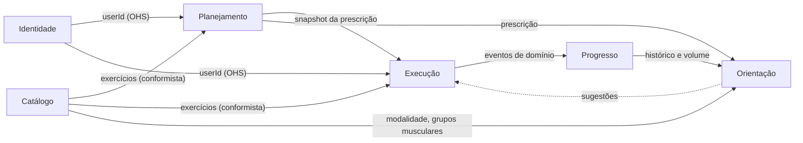

# Fase 1 — Domínio

> Escopo: MVP (gestão do treino, com orientação para um treino eficiente). Itens 🔥 são pontos levados para a Fase 2.

## 1. Linguagem ubíqua

O mesmo termo deve significar a mesma coisa no código, na interface e nas conversas.

| Termo | Definição | Não confundir com |
|---|---|---|
| **Exercício** | Movimento catalogado (ex.: "Supino reto com barra"), com grupos musculares, equipamento, **modalidade de registro** e animação | Item de treino |
| **Exercício do catálogo** | Mantido pelo sistema, igual para todos os usuários, somente leitura | |
| **Exercício personalizado** | Criado pelo usuário, visível só para ele | |
| **Modalidade de registro** | Como uma série daquele exercício é medida (ver §2) | |
| **Ficha** | Conjunto de treinos que o usuário segue durante um período. **Pode haver várias ativas** (ex.: "Musculação ABC" + "Core e mobilidade") | Treino |
| **Treino** | Uma divisão da ficha (ex.: "Treino A – Peito e tríceps") | Sessão |
| **Bloco** | Unidade de execução dentro do treino: um exercício sozinho, ou **vários executados em sequência sem descanso** (bi-set, tri-set, circuito) | Item |
| **Item de treino** | Exercício dentro de um bloco, com a sua **prescrição** | Exercício |
| **Prescrição** | O que se *planeja*: séries, repetições (faixa, ex.: 8–12), carga-alvo, esforço-alvo (RIR), descanso, técnica | Série realizada |
| **Técnica** | Forma de executar as séries: normal, drop-set, rest-pause | |
| **Sessão** | Uma *execução* de um treino de uma ficha, em uma data. Depois de encerrada, é **imutável** | Treino |
| **Série realizada** | O que foi *de fato* feito: medidas conforme a modalidade, tipo (aquecimento/trabalho), esforço percebido | Prescrição |
| **RIR** (*reps in reserve*) | Quantas repetições "sobraram" antes da falha. RIR 0 = falha; RIR 2 = daria para fazer mais 2 | |
| **Série efetiva** | Série de **trabalho** feita perto da falha (RIR ≤ 3). É a principal medida de estímulo | Série de aquecimento |
| **Tonelagem** | Σ (repetições × carga) das séries de trabalho com carga externa | Volume semanal |
| **Volume semanal** | Nº de **séries efetivas por grupo muscular** na semana | Tonelagem |
| **Recorde pessoal (PR)** | Melhor marca de um exercício, conforme a modalidade (maior carga, maior 1RM estimado, mais repetições, mais tempo) | |
| **Sugestão** | Recomendação gerada pela Orientação (carga da próxima série, ajuste de volume…). **O usuário sempre decide** | Prescrição |

**Distinções centrais do domínio:**

1. *Planejado* (Ficha → Treino → Bloco → Item → Prescrição) versus *realizado* (Sessão → Série realizada).
2. *Sugerido* (Orientação) versus *decidido* (o que o usuário prescreve ou executa). O sistema orienta, mas não impõe.

## 2. Modalidades de registro

Este é o ponto que mais afeta o modelo. Cada exercício declara uma modalidade, e a série realizada tem formato diferente para cada uma. Em TypeScript isso vira uma *discriminated union*.

| Modalidade | Exemplos | Campos da série | Recorde | Entra na tonelagem? |
|---|---|---|---|---|
| `carga_repeticoes` | Supino, agachamento, rosca | carga (kg), repetições, RIR | maior carga; maior 1RM estimado | ✅ |
| `peso_corporal` | Barra fixa, flexão, paralelas | repetições, carga adicional (kg, opcional; negativa = assistência), RIR | mais repetições; maior carga adicional | ❌ * |
| `tempo` | Prancha, isometrias | duração (s), carga adicional opcional | maior duração | ❌ |
| `cardio` | Esteira, bike, remo | duração, distância (opcional), intensidade (opcional) | maior distância/ritmo | ❌ |

\* Calcular a tonelagem com peso corporal exigiria saber o peso do usuário, e medidas corporais estão fora do MVP. Por isso a métrica **universal** de orientação é a *série efetiva*, que funciona para qualquer modalidade de força. Essa troca não é só uma limitação técnica: contar séries efetivas por grupo muscular é também a medida mais usada na literatura de hipertrofia.

**Unidade:** kg em todo o sistema. Os campos guardam números puros em kg; não há conversão.

## 3. Técnicas avançadas no modelo

| Técnica | Onde fica no modelo | Efeito na execução |
|---|---|---|
| **Bi-set / tri-set / circuito** | **Bloco** com 2 ou mais itens | O app alterna os exercícios; o descanso só começa no fim da volta |
| **Drop-set** | Técnica da prescrição; a série realizada tem **segmentos** (ex.: 40 kg × 10 → 30 kg × 6 → 20 kg × 6) | Uma série com várias cargas, sem descanso entre os segmentos |
| **Rest-pause** | Técnica da prescrição; a série realizada tem segmentos com pausa curta (10–20 s) | Timer curto entre segmentos |

Uma série com segmentos conta como **uma** série efetiva no volume semanal (abordagem conservadora). Na tonelagem, somam-se todos os segmentos.

## 4. Séries de aquecimento

**Decisão:** toda série realizada tem um tipo, `aquecimento` ou `trabalho`.

- O aquecimento é **registrado, mas não conta** para volume, tonelagem, recordes nem sugestões de progressão. Ele prepara o corpo e não gera estímulo de crescimento; contá-lo inflaria a evolução artificialmente.
- A Orientação pode **sugerir uma rampa de aquecimento** para o primeiro exercício composto do treino (ex.: 50% × 8, 70% × 5, 85% × 2 da carga de trabalho).

## 5. Orientação: o "treino eficiente"

O pedido de "guiar para um treino eficiente" adiciona um contexto novo, e ele é **o diferencial do produto**. Registrar séries muitos apps fazem; orientar bem é o que justifica usar este.

### Regras do MVP (determinísticas, sem IA)

| Regra | Como funciona |
|---|---|
| **Progressão de carga (dupla progressão)** | Prescrição de 8–12 repetições: se **todas** as séries de trabalho atingiram 12 com RIR ≥ 1, sugerir +2,5 kg em compostos ou +1 kg em isolados na próxima sessão. Abaixo de 8, sugerir manter ou reduzir |
| **Carga sugerida na próxima série** | Pré-preencher com o resultado da última sessão daquele exercício, ajustado pela regra acima |
| **Timer de descanso** | Usa o descanso da prescrição; se não houver, um padrão por tipo de exercício (compostos 2–3 min, isolados 60–90 s). Em bi-sets, conta só no fim da volta |
| **Volume semanal por grupo muscular** | Séries efetivas na semana, comparadas com uma faixa de referência (ponto de partida: ~10–20 séries por grupo por semana). Indica grupos abaixo da faixa ou em excesso |
| **Rampa de aquecimento** | Ver §4 |
| **Recordes** | Detecta e celebra |

### Fora do MVP

Deload automático, periodização, detecção de estagnação ou queda de desempenho e sugestões com IA.

### Princípios

- **Sugestão, nunca imposição.** O usuário aceita, ajusta ou ignora. Ignorar uma sugestão também é um dado útil.
- **Transparência.** Toda sugestão mostra o porquê (ex.: "Você fez 12 repetições em todas as séries com RIR 2: experimente 62,5 kg").
- **Faixas conservadoras e configuráveis.** As faixas de referência vêm da literatura de treinamento, mas são parâmetros, não constantes no código. Elas vão mudar.
- **Não é aconselhamento médico.** Mostrar um aviso no onboarding.

### Por que isso importa para a arquitetura

As regras de orientação são **funções puras**: recebem o histórico e a prescrição e devolvem uma sugestão. Como precisam funcionar **offline** (a sugestão de carga aparece na academia, sem sinal), elas têm que **rodar no cliente**.

Isso é a primeira justificativa concreta para a escolha de TypeScript ([ADR-0004](../adr/0004-typescript-como-linguagem-do-backend.md)): o mesmo pacote de domínio roda no app (offline) e no servidor (para recalcular ou validar). Esse pacote não pode depender de nenhuma API de plataforma, nem React, nem Cloudflare.

## 6. Event storming: linha do tempo

### Catálogo de exercícios

| Comando | Evento | Observação |
|---|---|---|
| Publicar catálogo (sistema) | `CatálogoPublicado` | Versionado; os clientes baixam e guardam em cache |
| Criar exercício personalizado | `ExercícioPersonalizadoCriado` | Usuário escolhe modalidade e grupos musculares |
| Editar exercício personalizado | `ExercícioPersonalizadoEditado` | Modalidade não pode mudar se já houver séries registradas |
| Arquivar exercício personalizado | `ExercícioPersonalizadoArquivado` | Arquivar, **não apagar**: sessões antigas ainda apontam para ele |

### Planejamento (fichas)

| Comando | Evento |
|---|---|
| Criar ficha | `FichaCriada` |
| Adicionar treino | `TreinoAdicionado` |
| Adicionar bloco / item | `BlocoAdicionado` / `ItemAdicionado` |
| Agrupar itens em bi-set / desagrupar | `ItensAgrupados` / `ItensDesagrupados` |
| Alterar prescrição | `PrescriçãoAlterada` |
| Reordenar | `BlocosReordenados` / `TreinosReordenados` |
| Remover item | `ItemRemovido` |
| Ativar / desativar ficha | `FichaAtivada` / `FichaDesativada` (várias podem estar ativas) |
| Arquivar ficha | `FichaArquivada` |

### Execução (sessões): o fluxo crítico offline

| Comando | Evento | Observação |
|---|---|---|
| Iniciar sessão a partir de um treino | `SessãoIniciada` | **Copia a prescrição** (ver §8). Não existe treino livre: toda sessão nasce de um treino |
| Registrar série | `SérieRegistrada` | Comando mais frequente; precisa funcionar 100% offline |
| Corrigir / remover série | `SérieCorrigida` / `SérieRemovida` | **Só com a sessão em andamento** |
| Aceitar / ignorar sugestão | `SugestãoAceita` / `SugestãoIgnorada` | Alimenta a análise da qualidade das sugestões |
| Substituir exercício na hora | `ExercícioSubstituído` | O aparelho está ocupado: troca por um equivalente (mesmo grupo muscular) |
| Pular exercício | `ExercícioPulado` | |
| Concluir sessão | `SessãoConcluída` | |
| (sistema) Encerrar por inatividade | `SessãoEncerradaPorInatividade` | Ver política abaixo |
| Descartar sessão | `SessãoDescartada` | Só com a sessão em andamento |

### Políticas (reações a eventos)

| Quando… | Então… |
|---|---|
| `SessãoConcluída` / `SessãoEncerradaPorInatividade` | Atualizar as projeções de evolução e de volume semanal (de forma incremental) |
| `SérieRegistrada` (trabalho) que supera o recorde | `RecordePessoalAtingido` |
| `SérieRegistrada` | Iniciar o timer de descanso (respeitando bi-sets) |
| `SessãoConcluída` | Calcular sugestões de progressão para a próxima sessão daquele treino |
| `SessãoConcluída` | Avançar a rotação **daquela ficha** (A → B → C → A) |
| Sessão sem série nova há mais de 3 h | `SessãoEncerradaPorInatividade`, com horário de fim = última série registrada. As séries registradas valem normalmente (**nenhum dado é perdido**). Avisar o usuário na próxima abertura. A sessão fica imutável como qualquer outra encerrada |

### Modelos de leitura (projeções)

- **Hoje**: próximo treino de **cada** ficha ativa, ordenados por quanto tempo faz desde a última sessão
- **Tela de execução**: blocos, última marca de cada exercício, carga sugerida, timer
- **Histórico de sessões**
- **Evolução por exercício**: conforme a modalidade (carga, 1RM estimado, repetições, tempo), com recordes
- **Volume semanal por grupo muscular**, comparado com a faixa de referência

## 7. Bounded contexts

| Contexto | Tipo de subdomínio | Responsabilidade | Offline? |
|---|---|---|---|
| **Identidade** | Genérico (terceirizar) | Conta, autenticação | Só a sessão de login em cache |
| **Catálogo** | De suporte | Exercícios, modalidades, grupos musculares, mídias | Leitura offline (cache) |
| **Planejamento** | **Core** | Fichas, treinos, blocos, prescrições | Leitura e escrita offline |
| **Execução** | **Core** | Sessões e séries realizadas | **Leitura e escrita offline (crítico)** |
| **Orientação** | **Core (diferencial)** | Regras de progressão, descanso, aquecimento, volume | **Roda no cliente**; funções puras |
| **Progresso** | De suporte | Projeções de evolução, recordes, volume semanal | Calculado localmente; recalculável |

> **Sincronização não é um bounded context.** É uma capacidade técnica transversal (infraestrutura).

### Mapa de contextos

- **Catálogo → demais (conformista):** os outros contextos referenciam o exercício pelo ID e aceitam o modelo do catálogo como ele é.
- **Planejamento → Execução (cliente-fornecedor):** a Execução recebe uma *cópia* da prescrição e não mantém vínculo vivo com ela.
- **Execução → Progresso (eventos):** o Progresso só lê eventos e nunca altera sessões.
- **Orientação (consumidora pura):** lê prescrição, histórico e catálogo, e devolve sugestões. **Não tem estado próprio** no MVP, o que a torna simples de testar e de rodar em qualquer lugar.

## 8. Agregados

| Agregado | Raiz | Invariantes |
|---|---|---|
| **Exercício personalizado** | `Exercicio` | Nome único por usuário; modalidade imutável depois de usada; não pode ser apagado se for usado (só arquivado) |
| **Ficha** | `Ficha` (Treinos → Blocos → Itens) | Pelo menos 1 treino com 1 item para ativar; bloco com 2 ou mais itens = bi-set ou circuito; faixa de repetições válida (mín ≤ máx); técnica compatível com a modalidade (ex.: sem drop-set em cardio) |
| **Sessão** | `Sessao` (séries realizadas, com segmentos) | Sempre originada de um treino; campos da série coerentes com a modalidade do exercício; valores ≥ 0; **depois de concluída ou encerrada por inatividade, nenhuma alteração é aceita**; 🔥 no máximo uma sessão em andamento por usuário (ver nota) |

**Snapshot da prescrição:** ao iniciar, a sessão copia a prescrição do treino. Editar a ficha depois **não muda** o histórico. Isso desacopla Execução de Planejamento e deixa cada sessão autossuficiente para o offline.

**Ficha como agregado único:** só o próprio usuário edita a ficha (não há concorrência entre pessoas), ela é pequena e as invariantes envolvem a ficha inteira. Vamos revisitar isso na sincronização entre dispositivos (QA-6).

**Consequência de sessões imutáveis:** uma sessão encerrada vira um **fato histórico**, que só se acrescenta e nunca se altera. Isso simplifica três coisas:

1. **Projeções:** o Progresso pode ser atualizado de forma incremental, sem recalcular tudo a cada mudança. Mesmo assim, vamos manter a capacidade de recalcular do zero, para quando uma regra de cálculo mudar.
2. **Sincronização:** uma sessão encerrada nunca entra em conflito. Os conflitos ficam limitados a fichas, exercícios personalizados e à sessão em andamento.
3. **Auditoria e confiança:** os recordes não podem ser "editados para cima".

O custo, aceito pelo dono do produto: um erro de digitação percebido só depois do fim da sessão fica no histórico.

**Nota (🔥 para a Fase 2):** "no máximo uma sessão em andamento" não pode ser garantido de forma estrita offline. O usuário pode iniciar sessões em dois dispositivos sem conexão. A estratégia de sincronização precisa definir o que acontece nesse caso. Proposta inicial: manter as duas, porque não há perda de dado, e só a interface alerta.

## 9. Decisões de produto

| # | Pergunta | Decisão | Origem |
|---|---|---|---|
| 1 | Tipos de exercício | Todas as modalidades: carga, peso corporal, tempo, cardio | Dono do produto |
| 2 | Técnicas avançadas | Bi-set/circuito, drop-set e rest-pause no MVP | Dono do produto |
| 3 | Unidade | kg | Dono do produto |
| 4 | Fichas ativas | Várias simultâneas | Dono do produto |
| 5 | Aquecimento | Registrado, fora de métricas e progressão; rampa sugerida | Proposta aceita por delegação |
| 6 | Treino livre | Não permitido: toda sessão nasce de um treino | Dono do produto |
| 7 | Sessão esquecida aberta | Encerrada automaticamente após 3 h sem série nova, com fim = última série | Dono do produto |
| 8 | Editar sessões passadas | Não permitido: sessão encerrada é imutável | Dono do produto |
| 9 | Orientação | Regras determinísticas no MVP; IA depois | Derivado do pedido de "treino eficiente" |
