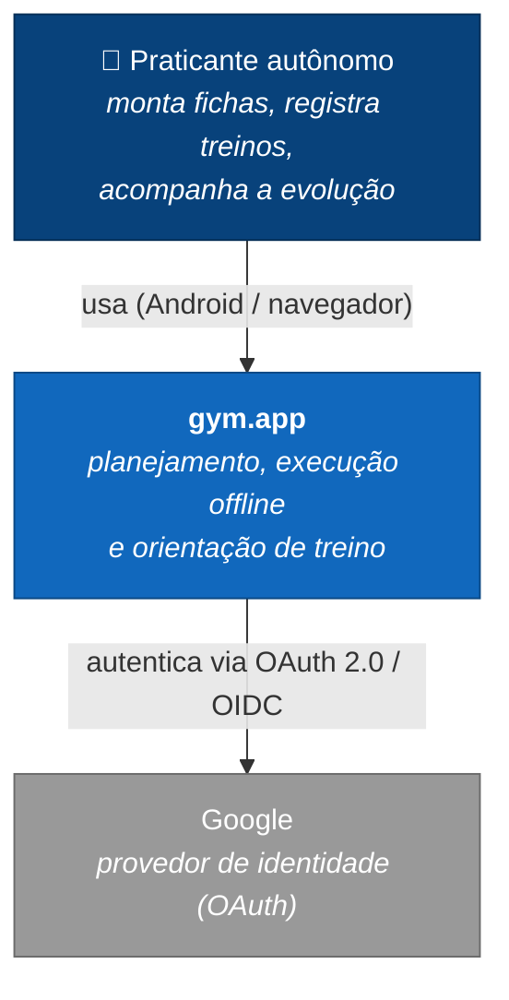
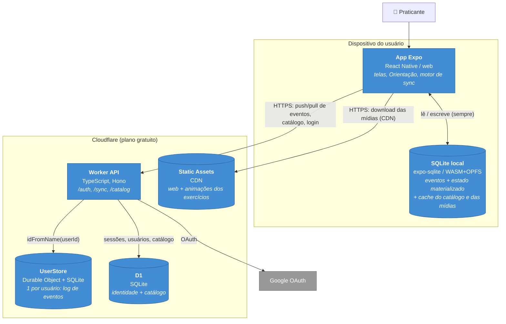

# Fase 2 — Visão arquitetural

> Consolida os ADRs [0004](../adr/0004-typescript-como-linguagem-do-backend.md)–[0009](../adr/0009-estrutura-do-monorepo.md) em diagramas C4 e rastreia cada atributo de qualidade até as táticas que o atendem.

## 1. Estilo arquitetural em uma frase

**Local-first com event sourcing por usuário**: o app grava eventos num SQLite local e os sincroniza com um log por usuário (um Durable Object para cada um), atrás de um **monólito modular serverless** (um Worker) na borda da Cloudflare.

O que **não** fazemos, e por quê:

| Não fazemos | Motivo |
|---|---|
| Microsserviços | 1 desenvolvedor, 20 usuários: a complexidade operacional não se paga |
| Banco central compartilhado | O isolamento por usuário (Durable Object) atende privacidade, LGPD e sincronização melhor |
| Interface consultando a API | Violaria QA-1: a interface lê sempre do banco local |
| CRDTs | Não há colaboração entre usuários (ver ADR-0006) |

## 2. C4: nível 1 (contexto)

Só um sistema externo no MVP. A Cloudflare não aparece aqui porque é *onde* o sistema roda (infraestrutura), não um sistema com que ele conversa.

## 3. C4: nível 2 (containers)

**Detalhes que fazem diferença:**

- **O mesmo Worker serve a web e a API**, na mesma origem (subdomínio gratuito `*.workers.dev`). Na web não há CORS, e é possível usar cookie de sessão. O app Android guarda a sessão no SecureStore e a envia como header `Cookie` (validado no spike S3).
- **Uma ressalva de segurança:** se o SQLite WASM exigir cabeçalhos COOP/COEP, o login Google não pode usar *popup* (COOP bloqueia a comunicação entre janelas). Usaremos o fluxo de **redirecionamento**. Isso será validado no spike.
- **As mídias são Static Assets servidos pela CDN** ([ADR-0010](../adr/0010-midias-do-catalogo-como-assets-estaticos.md)), sem executar o Worker e sem consumir a cota de requisições. O R2 ficou reservado para conteúdo enviado pelo usuário, depois do MVP.

## 4. Rastreabilidade: atributos de qualidade → táticas

| Atributo | Táticas | ADRs |
|---|---|---|
| **QA-1 Offline** | Escrita local primeiro; IDs gerados no cliente; fila de pendentes; idempotência por `event_id`; interface lê só do SQLite local; download explícito das mídias da ficha ativa para pasta não-volátil; sessão de autenticação expirada não bloqueia escrita | 0006, 0007, 0008, 0010 |
| **QA-2 Privacidade/LGPD** | Um Durable Object por usuário (isolamento pela topologia); exclusão = apagar o DO + linhas de identidade; exportação = log de eventos; sem terceiros com dados pessoais (exceto autenticação Google) | 0006, 0008 |
| **QA-3 Custo zero** | Serviços gratuitos sem prazo; DOs hibernam quando ociosos; mídias como Static Assets (sem cartão, fora da cota do Worker); sem lojas de apps (APK por sideload) | 0005, 0007, 0010 |
| **QA-4 Desempenho percebido** | Gravação local otimista (< 100 ms); sincronização em segundo plano | 0006 |
| **QA-5 Evolutividade** | Bounded contexts com fronteiras verificadas na CI; sync genérico (troca por LiveStore possível); porta `LocalDb`; hexagonal na API | 0009 |
| **QA-6 Consistência entre dispositivos** | Ordem total definida pelo servidor; *rebase*; "vence o último" determinístico; sessões imutáveis | 0006 |

## 5. Riscos técnicos → spike da Fase 3

| # | Risco | Impacto se falhar | Plano B |
|---|---|---|---|
| S1 | SQLite WASM + OPFS na web via Expo | Web sem offline confiável | Web em Vite com a mesma porta `LocalDb` (ADR-0007) |
| S2 | Expo + pnpm + Metro em monorepo | Atrito diário de build | `node-linker=hoisted` |
| S3 | Login Google no APK (deep link) e na web (redirecionamento) com Better Auth no Worker | Sem autenticação | Ajustar o fluxo; em último caso, um provedor gerenciado (ADR-0008, opção B) |
| S4 | Reconstruir o estado a partir de 1.000 eventos em menos de 1 s no Android | Lentidão ao abrir o app | Snapshots de estado (previsto no ADR-0006) |
| S5 | Build do APK sem custo (EAS gratuito ou local) e instalação por sideload | Sem app no celular | Build local com Android SDK |
| S6 | Animação em loop tocando offline a partir do cache | Experiência pior na academia | Imagens estáticas offline, animação só online |
