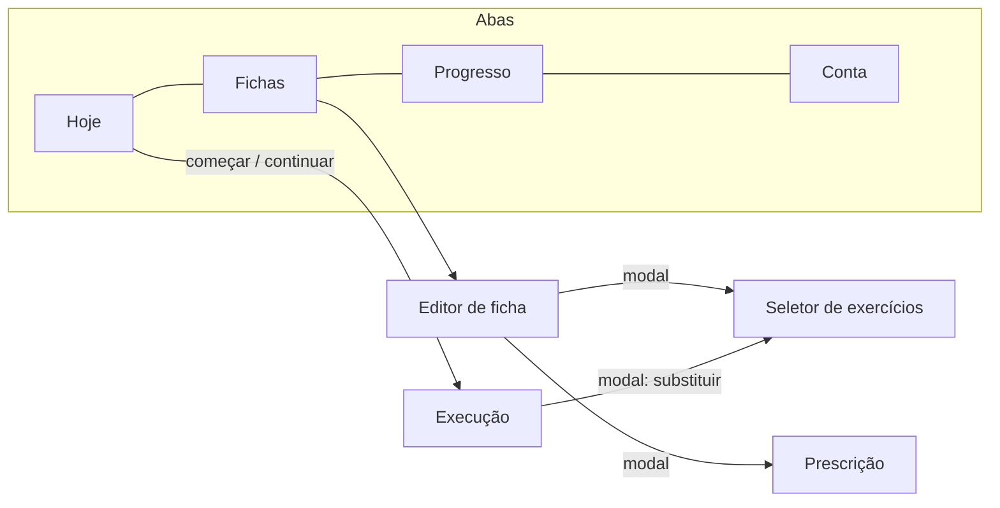

# Fase 4 — Interface (telas reais)

> Fecha a Fase 4: domínio v1 ([ADR-0012](../adr/0012-catalogo-de-eventos-v1.md)), catálogo ([ADR-0013](../adr/0013-catalogo-curado-como-snapshot-estatico.md)) e telas, com a identidade visual de [identidade-visual.md](../design/identidade-visual.md).

## Mapa de navegação (Expo Router)



| Tela | Contexto(s) | O que faz |
|---|---|---|
| **Hoje** | Planejamento + Execução | Treino em andamento; próximo treino de cada ficha ativa pela **rotação**; baixa antecipadamente as animações dos próximos treinos (QA-1) |
| **Fichas / Editor** | Planejamento | Criar ficha (já com "Treino A"), treinos, exercícios, **bi-set** (agrupar com o próximo), reordenar, ativar, arquivar |
| **Seletor** | Catálogo | Busca sem acento, filtro por grupo, miniaturas; cria exercício personalizado; modo **substituir** na execução, filtrando pelo mesmo grupo |
| **Prescrição** | Planejamento | Séries, faixa de reps, carga-alvo opcional, tempo, descanso, técnica, RIR-alvo, conforme a modalidade |
| **Execução** | Execução + Orientação + Progresso | Sugestão de carga com motivo, rampa de aquecimento, registro por modalidade, tipos trabalho/aquecimento/drop, RIR, **regra do bi-set** (sem descanso no meio da volta), timer, detecção de recorde, resposta à sugestão, substituir/pular, concluir/descartar |
| **Progresso** | Progresso + Orientação | Volume semanal por grupo vs. faixa 10–20, recordes (com 1RM estimado), histórico |
| **Conta** | Identidade + Sync | Login Google, status da sincronização e pendentes; logout avisa se há dados não enviados (ADR-0008) |

## Caminho de escrita (único)

```
Tela → comando do domínio (puro, valida invariantes) → Decisao
     → AppProvider.executar → motor.registrar (SQLite local, pendente) → recarrega estado
     → sync em segundo plano (agrupado em 1,5 s)
```

- **Nenhuma tela grava eventos "à mão".** Quando uma ação precisa de dois comandos (ex.: criar ficha + "Treino A"), eles são **encadeados**: o segundo é validado contra o estado com os eventos do primeiro (`encadear` em `aplicacao/consultas.ts`).
- **Tradução Planejamento → Execução** (snapshot da prescrição, ACL do ADR-0009 R5) fica na camada de aplicação do app (`snapshotDoTreino`), não no domínio.
- **Política de inatividade** roda ao abrir o app e ao voltar ao primeiro plano, com o `eventId` determinístico do domínio.
- **Época v1 do log** (ADR-0012): banco local `gym-v1.db` e Durable Object `idFromName("v1:" + userId)`.

## Validação

- **E2E automatizado** (`pnpm e2e:web`): build web de produção servida com COOP/COEP, Edge headless, fluxo completo em 12 passos (criar ficha → catálogo → bi-set → ativar → treinar → descanso no fim da volta → concluir → progresso → persistência após recarregar). Zero erros de página.
- 288 testes unitários e de propriedade, typecheck e fitness functions (52 módulos) na CI.

## Aprendizados (problemas reais encontrados pelo E2E)

| Problema | Causa | Correção |
|---|---|---|
| App vazio e **sem erro** após recarregar a página | OPFS dá acesso **exclusivo** ao arquivo do SQLite; o worker da página anterior ainda não tinha liberado. O spike S1 não pegou porque abria um navegador novo a cada execução | Nova tentativa com espera crescente; se persistir (outra aba aberta), **mensagem explícita** em vez de falha silenciosa |
| Pilha de telas crescendo a cada treino | `router.replace('/')` na execução empilhava **outra cópia** das abas | Voltar (`router.back()`) para quem abriu a execução; `replace` só sem histórico |
| `+` da carga encostando no `−` das repetições | Dois ajustadores lado a lado não cabiam em telas estreitas | Botões de 40 pt e número de 40 pt nos ajustadores (verificado por screenshot) |

Lição de arquitetura: **o spike prova a viabilidade; o E2E prova o produto**. Os três problemas só apareceram com o fluxo real de um usuário.

## Lapidação do MVP (2026-11-19)

| Item | Entrega |
|---|---|
| E2E na CI | O job `verificar` roda `pnpm e2e:web` com o Chrome do runner; screenshots viram artefato em caso de falha |
| Detalhe do treino | `/sessao/[sessaoId]`: duração, séries, kg movidos, cada exercício com suas séries (T/D/A) |
| Evolução por exercício | `/exercicio?id=…`: gráfico do 1RM estimado (ou melhor marca) por treino + tabela; spec da skill de dataviz (série única, barras finas, rótulo só no recorde/selecionado, toque = tooltip) |
| Volume com secundários | Contagem fracionada: principal = 1, secundário = 0,5 (`volumeSemanal` recebe pesos) |

**Aprendizados:**
- **IDs com "/" em rotas:** os IDs do catálogo (`pectorals/barbell-bench-press`) vão como **query** (`?id=`), não como segmento de rota dinâmica (que casa um único trecho do caminho).
- **E2E e abas:** telas de abas inativas continuam no DOM e não ficam `display: none`, só cobertas pela aba atual. O teste passou a exigir que o elemento esteja **no topo** (`elementFromPoint`), não só "visível" para o CSS.
- **Gráfico com 1 ponto:** base não-zero só com 2+ pontos (senão, "base" sem sentido).

## Pendências conhecidas

- Multi-aba na web: a segunda aba mostra a mensagem de banco em uso (sem coordenação entre abas).
- Gráfico de evolução mostra os últimos 16 treinos (sem filtro de período).
